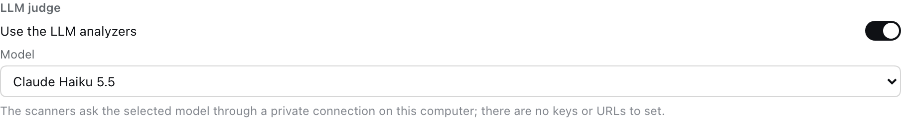
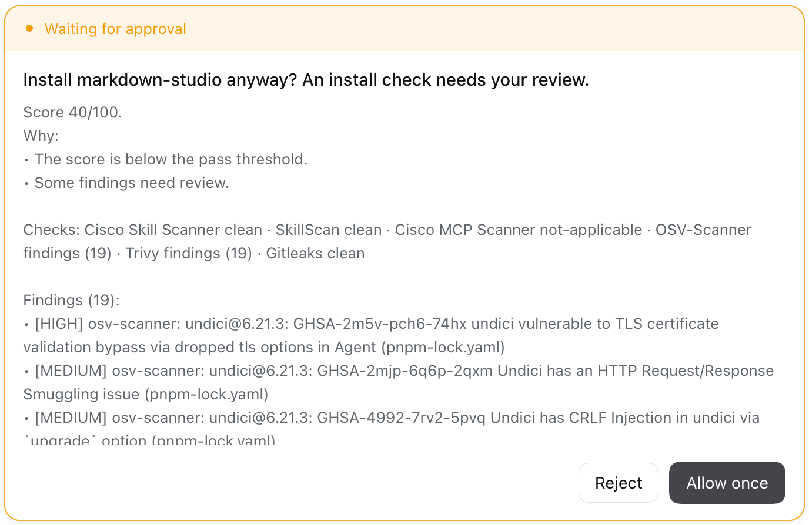

<div align="center">


# Airlock

**A security score before any plugin, skill or subagent reaches your DeepSeek Harness.**

[](https://www.npmjs.com/package/dsh-plugin-airlock)
[](LICENSE)
[](https://github.com/topics/dsh-plugin)

</div>

DeepSeek Harness plugins run with your permissions. They can use your shell, your files and your credentials. Third-party skills and subagent prompts can also carry **prompt injection**, **credential theft** or **data exfiltration** in plain text, so they never look like code.

Airlock puts every package in a **quarantine** first. It downloads it with install scripts disabled, runs six security scanners and an optional LLM judge, and then makes the call:

| | Result | What happens |
| :-: | --- | --- |
| 🟢 | **Passed** | Installs automatically. |
| 🟡 | **Review needed** | You see the findings. Tick *I reviewed these findings* and press **Install anyway**, or approve the card in the chat. |
| 🔴 | **High risk** | Blocked. Nothing was installed, and there is no override. |

<table>
<tr>
<td width="33%"></td>
<td width="33%"></td>
<td width="33%"></td>
</tr>
<tr>
<td align="center"><b>Blocked:</b> a skill that steals SSH keys</td>
<td align="center"><b>Review:</b> outdated dependencies</td>
<td align="center"><b>Passed:</b> a clean skill</td>
</tr>
</table>

## Why Airlock

- **It looks where attacks hide.** It scans `SKILL.md` files and the **subagent personas and prompts inside a bundle's config**, which ordinary dependency scanners never read.
- **One bad finding is enough.** The result follows the *worst* finding, not an average, so one credential-stealing instruction blocks a package however clean the rest is.
- **It fails closed.** A scanner that is missing, crashes, times out or returns output Airlock can't read never counts as clean. The same goes for an LLM judge that doesn't answer.
- **Nothing runs during the check.** Install scripts are disabled, MCP servers are never started, and package code is never loaded.
- **What it checked, not just what it found.** Every report opens with a plain-language summary of each security area: passed, found, or not applicable, and why.
- **Rated by impact, not just by severity.** A denial-of-service bug in a dependency isn't a data breach. Airlock reads each advisory's CVSS vector and rates it by what it can actually do.
- **Tamper-proof installs.** After installing, Airlock checks that the installed files are exactly the ones it scanned. Anything else is rolled back.
- **Everywhere you install.** It covers the Plugins page, the agent's `plugin_manager` tool in the chat, and updates.

## What it checks

| Security area | Scanner | What it finds |
| --- | --- | --- |
| Prompt injection and malicious instructions | [Cisco Skill Scanner](https://github.com/cisco-ai-defense/skill-scanner) and [SkillScan](https://pypi.org/project/skillscan/) | Instruction overrides, hidden exfiltration, credential harvesting, obfuscated payloads, macOS keychain abuse, in skills and in subagent prompts |
| MCP tool poisoning | [Cisco MCP Scanner](https://github.com/cisco-ai-defense/mcp-scanner) | Poisoned tool descriptions in shipped MCP tool definitions, checked statically with no server started |
| Known vulnerabilities in dependencies | [OSV-Scanner](https://google.github.io/osv-scanner/) and [Trivy](https://trivy.dev) | Advisories across every transitive dependency, labelled *Data exposure*, *Integrity or code execution* or *Denial of service* |
| Embedded secrets and credentials | [Gitleaks](https://github.com/gitleaks/gitleaks) and [Trivy](https://trivy.dev) | API keys, tokens and private keys shipped in the package, redacted in the report |
| Code that runs on load and MCP server commands | Airlock | `!!js` expressions and the MCP server commands a bundle declares |
| Anything else | Your own tools | Any tool that writes **SARIF** (Semgrep, CodeQL, …), added from the settings page |

### Optional LLM judge with your own models

Turn on the LLM judge and pick a model from **the same list as the chat**: DeepSeek, Claude, GPT, or whatever you've configured. The Cisco scanners then also ask that model to judge each skill and MCP tool. That catches attacks that rules miss, such as instructions that only become dangerous in context.

You don't paste an API key and there's no URL to set. Airlock forwards the scanners' requests to the chosen DSH model through a private, token-protected endpoint on `127.0.0.1`, so subscription logins work too.



### In the chat too

When the agent installs a plugin for you, a package that needs review shows the same report as an approval card. Green packages install, red ones are refused, and the agent never sees the findings text.



## Install

> **Requires a DeepSeek Harness with the install-gate hook.** The hook is a small, generic extension point that lets any plugin vet installs. It's [proposed upstream](https://github.com/deepseek-ai/deepseek-harness/discussions/12999), and until it ships you can run DSH from [`gabrielbav/deepseek-harness@feat/install-gate`](https://github.com/gabrielbav/deepseek-harness/tree/feat/install-gate). On a DSH without the hook, Airlock refuses to load and says why.

**1. Install the scanners you want.** Any you skip show as *Not installed*, and the settings page can install them with one click.

```sh
uv tool install cisco-ai-skill-scanner
uv tool install --python 3.12 skillscan
uv tool install --python 3.13 cisco-ai-mcp-scanner
brew install osv-scanner trivy gitleaks
```

**2. Add Airlock** in DSH: **Plugins → Add plugin → `dsh-plugin-airlock`**.

**3. Recommended: make it mandatory.** Add this to `~/.dsh/profiles/<profile>/cordis.patch.yml`, so nothing installs while Airlock isn't running. `dsh plugin add` on the command line is then refused too, because the CLI can't run the check.

```yaml
- id: plugin-manager
  name: "@deepseek-ai/dsh-plugin-manager"
  config:
    requireInstallGate: true
```

To upgrade Airlock itself later, remove these lines, upgrade, and add them back.

## Settings

Open **Plugins → Airlock**. Changes apply from the next scan.

| Section | What you can do |
| --- | --- |
| **Scanners** | Each scanner's status and path, an on/off switch, and **Install** for missing ones |
| **Custom SARIF scanners** | Add any tool that writes SARIF. In arguments, `{target}` is the scanned folder and `{output}` the report file. Example: `semgrep` with `scan --sarif --output {output} {target}`. |
| **Policy** | The score to pass, the score below which it blocks, which severity blocks package findings, which severity blocks dependency advisories, when to ask for review, how to rate denial-of-service-only advisories, and whether a pass needs the LLM judge |
| **LLM judge** | On/off, and a model chosen from your DSH model list |

Settings are saved in `<profile>/.airlock/settings.json`, and the same fields work on the `airlock` row in `cordis.yml`. Reports are kept in `<profile>/.airlock/reports/`. Every scanned plugin shows a *Security N* tag and its full report on its Plugins page.

## How the score works

The score starts at **100** and drops for every distinct finding: Critical 50, High 25, Medium 10, Low 3. Dependency advisories count half.

- 🔴 **Blocked** when a package finding is Critical, a dependency advisory is Critical, or package findings bring the score below **40**.
- 🟡 **Review** when the score is below **85**, any finding is Medium or worse, a scanner is missing or failed, or the package has skills or prompts but the LLM judge didn't run.
- 🟢 **Passed** otherwise.

The same advisory reported by OSV and Trivy counts once. Compiled CSS-module class names (`"popKey": "d2hvtW_popKey"`) are recognized as such, not as secrets. Every threshold is configurable.

## For plugin authors: add your own scanner

Airlock provides `ctx.airlock` to other plugins:

```ts
export const inject = ['airlock']
export function apply(ctx) {
  ctx.effect(() => ctx.airlock.registerScanner({
    id: 'house-rules',
    name: 'House rules',
    command: 'my-scanner',            // resolved before run; omit for in-process checks
    async run(scan) {                 // scan.subject, scan.fetchDir, scan.inventory, scan.executable, scan.signal
      return { id: 'house-rules', status: 'clean', findings: [], durationMs: 0, usedLlm: false }
    },
  }))
}
```

`run` must fail closed: return `error` for anything it doesn't recognize, never `clean`.

Airlock is one gate on top of DSH's generic install-gate hook. Other gates, such as publisher allow-lists, license policies, signature checks or a company approval service, can run beside it, and the strictest ruling wins.

## Privacy and safety

- **The package's code stays on your machine.** OSV-Scanner looks up dependency names and versions in the public [OSV database](https://osv.dev), and Trivy downloads its vulnerability database. With the LLM judge on, the skill, prompt and MCP tool text goes to the model you chose.
- **The agent never sees finding text.** Findings can quote the scanned package, which might contain instructions aimed at an AI, so the model only learns the score and the result.
- **Secrets stay redacted.** Secrets found in a package are redacted in Gitleaks' report.

## Limitations

- No scanner analyses what a plugin's JavaScript does at runtime. Add a SARIF scanner such as Semgrep for code rules.
- Skills copied into skill folders by hand, outside the plugin manager, are not scanned.
- An update that needs review can't be confirmed from the update dialog yet. Uninstall the plugin, then install the new version from **Add plugin**.
- A git-hosted bundle that builds in a `prepare` script installs different files than the ones scanned, so the tamper check refuses it. Publish such bundles to npm instead.
- The settings page is in English, Portuguese and Chinese. The security report is in all eight DSH languages.

## Develop

```sh
pnpm install
pnpm build   # lib/index.js (Host, self-contained) and lib/client.js (browser)
pnpm test
```

## License

[MIT](LICENSE)
