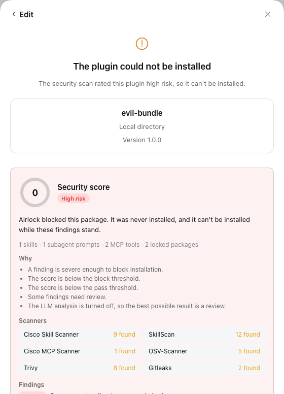
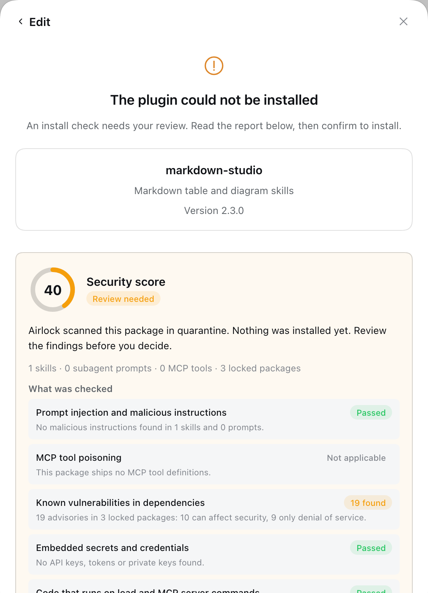
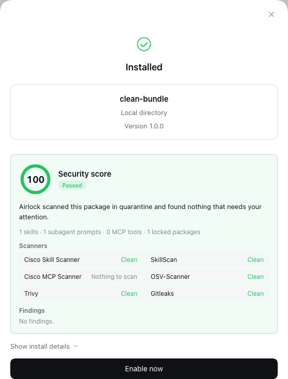

# Airlock for DeepSeek Harness

Airlock is a security install gate for [DeepSeek Harness](https://github.com/deepseek-ai/deepseek-harness). Before any third-party plugin, skill or subagent bundle reaches your profile, Airlock downloads it into a quarantine folder with install scripts disabled, scans it, and gives it a **security score**:

| Result | What happens |
| --- | --- |
| 🟢 **Pass** | Installs automatically. |
| 🟡 **Review** | Shows the findings. On the Plugins page you tick "I reviewed these findings" and press **Install anyway**; in a conversation the agent asks you with an approval card. A session in **Full access** never asks for approval, so there the agent tells you to review it on the Plugins page. |
| 🔴 **Block** | Refused. There is no override. |

| Blocked | Review | Passed |
| --- | --- | --- |
|  |  |  |

The result follows the **worst** finding, not the average: one critical finding blocks however clean the rest is. A scanner that is missing, crashes or prints something Airlock cannot read never counts as clean.

Airlock is one install gate built on DeepSeek Harness's generic install-gate hook; other gates (allowlists, license or signature policies) can run beside it, and the strictest ruling wins.

> **Requires** a DeepSeek Harness build with the plugin manager's install gate (`@deepseek-ai/dsh-plugin-manager/install-gate`), proposed upstream from [gabrielbav/deepseek-harness `feat/install-gate`](https://github.com/gabrielbav/deepseek-harness/tree/feat/install-gate). On a release without it, Airlock refuses to load and says so.

## What it scans

| Scanner | What it reads | Finds |
| --- | --- | --- |
| [Cisco Skill Scanner](https://github.com/cisco-ai-defense/skill-scanner) | `SKILL.md` skills and subagent prompts Airlock extracts from the bundle's config | prompt injection, exfiltration, malicious instructions |
| [SkillScan](https://pypi.org/project/skillscan/) | the same skills and prompts | credential theft, obfuscation, macOS keychain abuse |
| [Cisco MCP Scanner](https://github.com/cisco-ai-defense/mcp-scanner) | MCP tool definitions the package ships (static, no server is started) | tool poisoning |
| [OSV-Scanner](https://google.github.io/osv-scanner/) | the quarantine lockfile, with every transitive dependency | known vulnerabilities |
| [Trivy](https://trivy.dev) | the lockfile, and the package files | vulnerabilities, secrets, misconfigurations |
| [Gitleaks](https://github.com/gitleaks/gitleaks) | the package files | embedded credentials |

Airlock itself also reports configuration that runs JavaScript when it loads (`!!js`, informational: plugin code runs with full permissions anyway) and declared MCP server commands.

**How findings are rated, with security first:**
- **Dependency advisories are rated by impact.** The impact is read from the advisory's CVSS vector, and from its CWE when there is no vector. A denial-of-service-only advisory (it can slow or crash, but cannot read data or run code) is capped at **Low** by default. Advisories that affect data or integrity keep their rating and are labelled "Data exposure" or "Integrity or code execution". The same advisory reported by OSV and Trivy counts once.
- **Secrets:** provider-specific rules (GitHub, Stripe, AWS…) are High. The generic name-and-entropy rule is Medium. Compiled CSS-module class maps (`"popKey": "d2hvtW_popKey"`) are recognized and dropped.
- **The LLM requirement** applies only when the package has skills, prompts or MCP tools for the judge to read.

The card opens with **What was checked**: one line per security area, saying whether it passed, what was found, or why it didn't apply. For example, "This package has no skills or subagent prompts".

After the real installation, Airlock checks that the installed files are exactly the ones it scanned; any difference rolls the installation back.

## Install

1. Install the scanners you want. Any that are missing show as "Not installed" on the settings page, which can install them for you:

   ```sh
   uv tool install cisco-ai-skill-scanner
   uv tool install --python 3.12 skillscan
   uv tool install --python 3.13 cisco-ai-mcp-scanner
   brew install osv-scanner trivy gitleaks
   ```

2. Install Airlock from the Plugins page: **Add plugin** → `dsh-plugin-airlock` (or a path to a checkout).

3. Optional, recommended: refuse every installation while Airlock is not running. Add this to your profile patch (`~/.dsh/profiles/<profile>/cordis.patch.yml`). Install Airlock first; with this set, nothing installs without a gate.

   ```yaml
   - id: plugin-manager
     name: "@deepseek-ai/dsh-plugin-manager"
     config:
       requireInstallGate: true
   ```

   With it set, `dsh plugin add` refuses too, because the command line cannot run gates; install from the Plugins page or the chat.

   **Recovery and upgrades:** with `requireInstallGate: true`, nothing installs while Airlock is off or uninstalled, including Airlock itself. To install or upgrade Airlock, remove the `requireInstallGate` lines, install, then add them back. `dsh plugin install` with no package names (reinstalling the profile lockfile) still works.

## Settings

Open **Plugins → Airlock**. Settings are saved in `<profile>/.airlock/settings.json` and apply from the next scan.

- **Scanners:** status and path of each scanner, an on/off switch, and **Install** for a missing one.
- **Custom SARIF scanners:** add any tool that writes a [SARIF](https://sarifweb.azurewebsites.net/) report. In the arguments, `{target}` is the scanned directory and `{output}` a report file; without `{output}`, the report is read from standard output. Choose whether it scans the package files or the dependency lockfile. Example for Semgrep: command `semgrep`, arguments `scan`, `--sarif`, `--output`, `{output}`, `{target}`.
- **Policy:** pass and block scores, which severity blocks package findings and dependency vulnerabilities, from which severity a review is needed, and whether a pass requires the LLM analysis.
- **LLM judge:** turn on the Cisco scanners' LLM analysis and pick a model from the same list as the chat's model selector. Airlock answers the scanners through a private, token-protected endpoint on `127.0.0.1` that forwards to the chosen DSH model, so subscription logins work and there are no keys or URLs to set. A judge that fails or answers in the wrong format counts as not run, never as clean.

The same fields can be set in `cordis.yml` on the `airlock` row; saved settings override them. Row-only fields: `searchPaths`, `scannerTimeoutMs`, `maxFindings`, `promptMinChars`, `maxJsonBytes`, `policy.weights`, `installCommands`, `installTimeoutMs`.

## Add a scanner from another plugin

Airlock provides `ctx.airlock` to other plugins:

```ts
export const inject = ['airlock']
export function apply(ctx) {
  ctx.effect(() => ctx.airlock.registerScanner({
    id: 'house-rules',
    name: 'House rules',
    command: 'my-scanner',            // resolved before run; omit for in-process scanners
    async run(scan) {                 // scan.subject, scan.fetchDir, scan.inventory, scan.executable, scan.signal
      return { id: 'house-rules', status: 'clean', findings: [], durationMs: 0, usedLlm: false }
    },
  }))
}
```

`run` must fail closed: return `error` for anything it does not recognize, never `clean`.

## Privacy and safety

- The package is never executed: install scripts are disabled, MCP servers are not started, and SkillScan's sandbox stage is not used.
- Finding text comes from the scanned package and is untrusted. The UI renders it as plain text, and the model only sees the score, the result and whether you accepted or declined.
- Secrets found by Gitleaks are redacted in its report.

## Limitations

- Scanners do not analyse what a plugin's JavaScript does at runtime; add a SARIF scanner such as Semgrep for code rules.
- Skills copied into skill folders by hand, outside the plugin manager, are not scanned.
- A git bundle that builds in a `prepare` script installs built files that differ from the unbuilt scanned copy, so the tamper check refuses it; publish such bundles to npm.
- Settings-page text is in English, Portuguese and Chinese; the score card is in all eight DSH languages.
- An update that comes back yellow fails and keeps the installed version, because the update dialog has no review step yet. Uninstall and reinstall the new version from **Add plugin** to review it.
- Dependency advisories lower the score and ask for review, but block only at **Block on dependency vulnerabilities at** (critical by default), so an old dependency alone never turns a package red.

## Develop

```sh
pnpm install
pnpm build        # lib/index.js (Host), lib/client.js (browser)
pnpm test
```

The Host half is one self-contained ES module (execa and yaml are bundled), so installing the plugin adds no runtime dependencies. The browser half is CommonJS wrapped in the DSH page's module-loader factory by `scripts/wrap-client.mjs`; React and `@deepseek-ai/dsh-client-ui-primitives` come from the page.

## License

MIT
